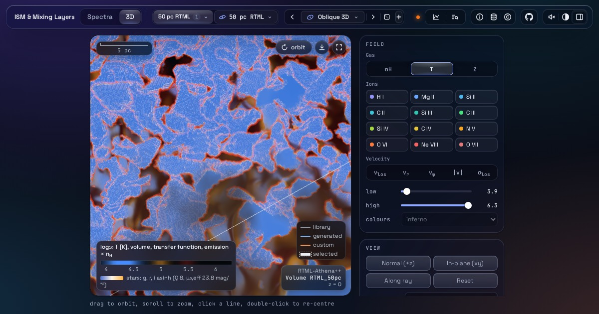
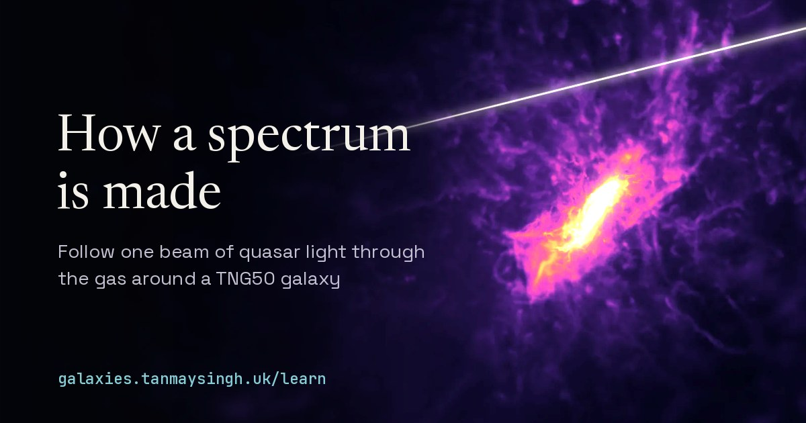

<p align="center">
  <a href="https://ism.tanmaysingh.uk/#id=edge_i008&ions=HI,MgII,SiIII,CIV,OVI&lay=1&tab=3d"></a>
</p>
<p align="center"><sub>Parsec &amp; sub-parsec multiphase gas in the 5-level 3D WebGL2 volume explorer at <a href="https://ism.tanmaysingh.uk/#id=edge_i008&ions=HI,MgII,SiIII,CIV,OVI&lay=1&tab=3d">ism.tanmaysingh.uk</a> — switch live between the <b>50 pc &rarr; 2517 AU Radiative Turbulent Mixing Layer (<code>RTML_50pc</code>)</b> and the <b>1 kpc &rarr; 0.048 pc Stratified Multiphase ISM (<code>ISM_1kpc</code>)</b>.</sub></p>

> [!NOTE]
> Under active development — we would love to hear your [ideas, feedback or bugs](https://github.com/tanmay-starslab/multiphase-ism/issues)! Want to visualize your own Athena++, FLASH, Pluto, ENZO, RAMSES, AREPO, GIZMO, or yt-compatible HDF5/NumPy simulation in 3D? Jump straight to the [**Bring-Your-Own-Simulation CLI (`python -m tngsight.ingest`)**](#-bring-your-own-simulation-cli-python--m-tngsightingest).

<h1 align="center">Seeing the Interstellar Medium &amp; Multiphase Mixing Layers</h1>

<p align="center"><b>Fly through fractal radiative turbulent mixing layers and stratified interstellar medium fountains from 1 kpc down to 2,517 AU, shine a background beam of light across the interface, and read the 12-ion UV/EUV/X-ray absorption spectrum it leaves behind.</b></p>

<p align="center">
  <a href="https://ism.tanmaysingh.uk/"><b>Launch Live 3D &amp; Spectra Explorer &rarr;</b></a>
  &nbsp;&middot;&nbsp;
  <a href="https://ism.tanmaysingh.uk/#id=edge_i008&tab=3d"><b>50 pc RTML in 3D &rarr;</b></a>
  &nbsp;&middot;&nbsp;
  <a href="https://ism.tanmaysingh.uk/#sim=ism&g=ISM_1kpc&id=edge_i008&tab=3d"><b>1 kpc ISM in 3D &rarr;</b></a>
  &nbsp;&middot;&nbsp;
  <a href="BYO_SIMULATION.md"><b>BYO-Simulation CLI &rarr;</b></a>
</p>

<p align="center">
  <a href="https://ism.tanmaysingh.uk"></a>
  <a href="https://galaxies.tanmaysingh.uk"></a>
  <a href="https://icm.tanmaysingh.uk"></a>
  <a href="https://igm.tanmaysingh.uk"></a>
  <a href="BYO_SIMULATION.md"></a>
  <a href="LICENSE"></a>
</p>

---

## 🌌 Four-Portal Cosmic Scale Hierarchy ($2517\text{ AU} \to 303\text{ Mpc}$)

`multiphase-ism` is the smallest-scale anchor of a **four-portal interactive astrophysics atlas** spanning **10 orders of magnitude in spatial scale** — from sub-parsec Kelvin–Helmholtz radiative mixing layers ($2517\text{ AU}$) to $303\text{ Mpc}$ cosmological volumes:

| Scale Regime | Live Web Portal | GitHub Repository | Physical Domain | Spatial Extent & Finest Voxel | Simulations & Physics |
| :--- | :--- | :--- | :--- | :--- | :--- |
| **1. ISM & Mixing Layers** *(this repo)* | [**ism.tanmaysingh.uk**](https://ism.tanmaysingh.uk) | [`tanmay-starslab/multiphase-ism`](https://github.com/tanmay-starslab/multiphase-ism) | Radiative turbulent mixing layers (RTML) & stratified multiphase ISM | **$50\text{ pc} \to 1\text{ kpc}$** (finest cell **$2517\text{ AU} = 0.0122\text{ pc}$**) | `RTML_50pc` (Athena++ KHI + radiative cooling) & `ISM_1kpc` (TIGRESS stratified fountain) + **BYO-Simulation CLI** |
| **2. Circumgalactic Medium (CGM)** | [**galaxies.tanmaysingh.uk**](https://galaxies.tanmaysingh.uk) | [`tanmay-starslab/cgm-atlas`](https://github.com/tanmay-starslab/cgm-atlas) | Galaxy halos, cold streams, outflows & stellar disks | **$3\text{ kpc} \to 800\text{ kpc}$** (finest cell **$11.7\text{ pc}$**) | **275 galaxies** across TNG50, FIRE-2, SIMBA, Auriga, TNG100, TNG300, Illustris-1, AGORA & CAMELS/EAGLE |
| **3. Intracluster Medium (ICM)** | [**icm.tanmaysingh.uk**](https://icm.tanmaysingh.uk) | [`tanmay-starslab/icm-atlas`](https://github.com/tanmay-starslab/icm-atlas) | Massive galaxy clusters, cool cores, ram-pressure tails & WHIM filaments | **$125\text{ kpc} \to 4\text{ Mpc}$** (finest cell **$488\text{ pc}$**) | TNG300-1 & TNG-Cluster massive halos ($\log M_{200c}/M_\odot = 14.4\text{–}15.2$) |
| **4. Intergalactic Medium (IGM)** | [**igm.tanmaysingh.uk**](https://igm.tanmaysingh.uk) | [`tanmay-starslab/igm-atlas`](https://github.com/tanmay-starslab/igm-atlas) | Whole-box cosmic web filaments, sheets, voids & nodes | **$35\text{ Mpc} \to 303\text{ Mpc}$** (5-level full-box octrees) | **6 whole-box simulations**: SIMBA-100, TNG100-1, TNG300-1, TNG50-1, Illustris-1 & CAMELS-TNG |

---

## 🔬 Direct Deep Links into Live 3D Volumes & Sightlines

Click any link below to jump directly into the live WebGL2 3D volume ray-marcher or the 12-ion Voigt spectrum fitter at [**ism.tanmaysingh.uk**](https://ism.tanmaysingh.uk):

### 1. `RTML_50pc` — $50\text{ pc} \to 2517\text{ AU}$ Radiative Turbulent Mixing Layer (`RTML-Athena++`)
Shear-driven Kelvin–Helmholtz instability coupled with rapid radiative cooling ($t_{\text{cool}} \ll t_{\text{shear}}$) creates a corrugated fractal boundary layer where hot wind ($T \sim 10^6\text{ K}$) and cold dense gas ($T \sim 10^2\text{–}10^4\text{ K}$) mix into intermediate-temperature ($T \sim 10^{4.5}\text{–}10^{5.5}\text{ K}$) `C IV`, `Si IV`, `N V`, and `O VI` absorbers ([Fielding et al. 2020](https://doi.org/10.3847/2041-8213/ab8225); [Tan, Oh & Gronke 2021](https://doi.org/10.1093/mnras/stab053); [Gronke & Oh 2018](https://doi.org/10.1093/mnrasl/sly132); [Ji, Oh & Masterson 2019](https://doi.org/10.1093/mnras/stz1248)).

- **Live 3D Volume Views (`RTML_50pc`)**:
  - [**3D Gas Density ($n_{\text{H}}$) & Fractal KHI Interface**](https://ism.tanmaysingh.uk/#id=edge_i008&ions=HI,MgII,SiIII,CIV,OVI&lay=1&tab=3d)
  - [**In-plane (`xy`) Shear-Layer Sightline + 12-Ion Spectra (`edge_i008`)**](https://ism.tanmaysingh.uk/#id=edge_i008&ions=HI,MgII,SiIII,CIV,OVI&lay=1&tab=spectra)
  - [**Normal (`+z`) Interface-Crossing Sightline (`face_i045`)**](https://ism.tanmaysingh.uk/#id=face_i045&ions=HI,MgII,SiIII,CIV,OVI&lay=1&tab=spectra)
  - [**Oblique 3D Multi-Component Eddy Sightline (`rand_i085`)**](https://ism.tanmaysingh.uk/#id=rand_i085&ions=HI,MgII,SiIII,CIV,OVI&lay=2R&tab=spectra)

### 2. `ISM_1kpc` — $1\text{ kpc} \to 0.048\text{ pc}$ Stratified Multiphase ISM & Superbubble Fountain (`TIGRESS-ISM`)
A $1\text{ kpc}$ stratified galactic disk section resolving cold molecular/CNM filaments ($T \sim 30\text{–}300\text{ K}$), warm neutral and ionized layers ($T \sim 8000\text{ K}$), and supernova-driven hot superbubble chimneys ($T > 10^6\text{ K}$) launching multiphase fountain clouds ([Kim & Ostriker 2017](https://doi.org/10.3847/1538-4357/aa8599); [Kim et al. 2020](https://doi.org/10.3847/1538-4357/ab9c1c)).

- **Live 3D Volume Views (`ISM_1kpc`)**:
  - [**3D Stratified Multiphase ISM & Superbubble Fountain (`ISM_1kpc`)**](https://ism.tanmaysingh.uk/#sim=ism&g=ISM_1kpc&id=edge_i008&ions=HI,MgII,SiIII,CIV,OVI&lay=1&tab=3d)
  - [**In-plane (`xy`) Midplane Sightline + 12-Ion Spectra (`ISM_1kpc`)**](https://ism.tanmaysingh.uk/#sim=ism&g=ISM_1kpc&id=edge_i008&ions=HI,MgII,SiIII,CIV,OVI&lay=1&tab=spectra)
  - [**Normal (`+z`) Vertical Fountain Sightline (`ISM_1kpc`)**](https://ism.tanmaysingh.uk/#sim=ism&g=ISM_1kpc&id=face_i045&ions=HI,MgII,SiIII,CIV,OVI&lay=1&tab=spectra)
  - [**Oblique 3D Superbubble Chimney Sightline (`ISM_1kpc`, Compare $R$ & $\text{S/N}$)**](https://ism.tanmaysingh.uk/#sim=ism&g=ISM_1kpc&id=rand_i085&ions=HI,MgII,SiIII,CIV,OVI&lay=4&tab=spectra)

---

## 🧊 5-Level Sub-Parsec to Kiloparsec Octree Architecture (`L0` $\to$ `L4`)

Both simulation volumes are encoded into **five nested $256^3$ 3D WebGL2 textures (`L0` through `L4`)** across **18 physical fields** (`nH`, `T`, `Z`, `vx`, `vy`, `vz`, and all 12 ions `HI`, `MgII`, `SiII`, `CII`, `SiIII`, `CIII`, `SiIV`, `CIV`, `NV`, `OVI`, `NeVIII`, `OVII`), plus $g, r, i$ stellar + 3D dust cubes (`S0`–`S4`):

| Octree Level | Grid Resolution | `RTML_50pc` Box Extent ($2 \times \text{half}$) | `RTML_50pc` Voxel Size | `ISM_1kpc` Box Extent ($2 \times \text{half}$) | `ISM_1kpc` Voxel Size | Physical Structures Resolved |
| :---: | :---: | :---: | :---: | :---: | :---: | :--- |
| **`L0`** | $256^3$ | $50.0\text{ pc}$ ($\pm 25.0\text{ pc}$) | $0.195\text{ pc}$ ($40,286\text{ AU}$) | $1000\text{ pc}$ ($\pm 500\text{ pc}$) | $3.906\text{ pc}$ | Full shear layer / stratified ISM disk & fountain chimney |
| **`L1`** | $256^3$ | $25.0\text{ pc}$ ($\pm 12.5\text{ pc}$) | $0.0977\text{ pc}$ ($20,143\text{ AU}$) | $250\text{ pc}$ ($\pm 125\text{ pc}$) | $0.977\text{ pc}$ | Primary Kelvin–Helmholtz billows & superbubble walls |
| **`L2`** | $256^3$ | $12.5\text{ pc}$ ($\pm 6.25\text{ pc}$) | $0.0488\text{ pc}$ ($10,072\text{ AU}$) | $62.5\text{ pc}$ ($\pm 31.25\text{ pc}$) | $0.244\text{ pc}$ ($50,358\text{ AU}$) | Secondary shear roll-ups & entrained CNM/WNM clouds |
| **`L3`** | $256^3$ | $6.25\text{ pc}$ ($\pm 3.125\text{ pc}$) | $0.0244\text{ pc}$ ($5,036\text{ AU}$) | $25.0\text{ pc}$ ($\pm 12.5\text{ pc}$) | $0.0977\text{ pc}$ ($20,143\text{ AU}$) | Radiative cooling skins & shattered cloudlet streams |
| **`L4`** | $256^3$ | **$3.125\text{ pc}$** ($\pm 1.5625\text{ pc}$) | **$0.0122\text{ pc}$ ($2,517\text{ AU}$)** | **$12.5\text{ pc}$** ($\pm 6.25\text{ pc}$) | **$0.0488\text{ pc}$ ($10,068\text{ AU}$)** | Sub-parsec $T \sim 10^{4.5}\text{–}10^{5.5}\text{ K}$ cooling knots & acoustic cores |

### Sightline & Camera Geometry Convention

Because mixing layers and stratified ISM patches are defined by an interface or midplane normal ($\hat{z}$) and a shear or midplane plane ($xy$), all sightlines and 3D camera presets use physical mixing-layer / stratified-ISM geometry labels:

| Display Label | Internal Key | Physical Sightline / Camera Direction |
| :--- | :---: | :--- |
| **`Normal (+z)`** | `"face-on"` | Across the radiative mixing interface or perpendicular to the stratified ISM midplane ($\hat{n}_{\text{los}} \parallel +\hat{z}$) |
| **`In-plane (xy)`** | `"edge-on"` | Along the Kelvin–Helmholtz shear layer or parallel to the stratified ISM midplane ($\hat{n}_{\text{los}} \parallel \hat{x}$) |
| **`Oblique 3D`** | `"random"` | Oblique 3D ray cutting across multiple corrugated KHI billows or fountain chimneys |

---

## ✨ Key Interactive Capabilities

<table>
  <tr>
    <td width="50%">
      <a href="https://ism.tanmaysingh.uk/#id=edge_b100_a090&ions=HI,MgII,SiIII,CIV,OVI&lay=1&tab=3d"></a>
    </td>
    <td width="50%">
      <a href="https://ism.tanmaysingh.uk/learn/how-a-spectrum-is-made/"></a>
    </td>
  </tr>
</table>

1. **Liquid-Metal Simulation Regime Switcher (`#top-sim.pbtn.lq-metal` + `#sim-pop`)**:
   - Switch instantaneously in the top bar between **`50 pc RTML`** (`Volume RTML_50pc`, $50\text{ pc} \to 2517\text{ AU}$) and **`1 kpc ISM`** (`Volume ISM_1kpc`, $1\text{ kpc} \to 0.048\text{ pc}$).
   - Preserves your active sightline geometry (`Normal (+z)`, `In-plane (xy)`, `Oblique 3D`), relative impact parameter $b$, spectrograph resolving power $R$, and $\text{S/N}$ across scales.
2. **Real-Time 3D WebGL2 Ray-Marching (`L0`–`L4` Sliding Octree Window)**:
   - Inspect **Column Density (Integral)** or **3D Radiative Transfer (Volume + 1D/2D Transfer Function Editor)** across `nH`, `T`, `Z`, 12 ions, and 5 kinematic views (`vlos`, `sigmalos`, `vmag`, `vr`, `vphi`).
   - Built-in **1D & 2D Transfer Function (TF) Editor** with Gaussian phase bands (`THOR`, `Nelson+16`, `Isosurfaces`, `Clouds`), gradient-magnitude boundary lighting (`gradAt` with empty-neighbor guard), and density-squared emissivity weighting $(n_{\text{H}} / n_0)^\gamma$.
3. **In-Browser 12-Ion Voigt Profile Synthesis & Levenberg–Marquardt Fitter**:
   - Real-time Gaussian LSF convolution ($R = 5,000\text{–}150,000$ in UV/EUV; $R = 100\text{–}5,000$ in X-ray), Poisson+Gaussian noise realization ($\text{S/N} = 2\text{–}100$), and automated multi-component Voigt fitting (`log N`, `b`, `v`) with $\Delta\text{BIC}$ component pruning in a Web Worker.
   - Cast **any custom 3D sightline directly in your browser** through the 5-level octree cubes via the Rust/WebAssembly + JS streaming ray sampler (`castCubeRay`).

---

## 🛠️ Bring-Your-Own-Simulation CLI (`python -m tngsight.ingest`)

Turn **any** hydrodynamic or magnetohydrodynamic simulation snapshot into a self-contained **5-level 3D WebGL2 volume + 12-ion Voigt absorption spectrum explorer** with a single command. See [**BYO_SIMULATION.md**](BYO_SIMULATION.md) for the complete technical reference.

### Supported Simulation Codes & Formats

| Simulation Code / Format | Input Extensions | Grid / Particle Deposit Engine |
| :--- | :--- | :--- |
| **Athena++ / AthenaK** | `.athdf`, `.h5` | Uniform Cartesian or SMR/AMR mesh via `h5py` / `yt` |
| **FLASH / Pluto / ENZO / RAMSES** | `plt_cnt_*`, `.dbl`, `.hierarchy`, `info_*.txt` | Adaptive mesh refinement (AMR) covering grid via `yt` |
| **AREPO / IllustrisTNG / Auriga** | `snap_*.hdf5`, `cutout_*.hdf5` | Voronoi moving mesh kernel deposit (`tngsight.viz_Export`) |
| **GIZMO / FIRE-2 / SIMBA / Gadget-4** | `snapshot_*.hdf5` | SPH / MFM smoothing-kernel octree deposit |
| **Generic HDF5 / Raw NumPy** | `.h5`, `.hdf5`, `.npz`, `.npy` | Direct 3D array or particle $(x, y, z, m, \rho, T, Z, \mathbf{v})$ ingestion |

### 1. Ingest Your Own Simulation (HDF5, yt, or NumPy)

```bash
# Ingest an Athena++, FLASH, ENZO, RAMSES, AREPO, GIZMO, or generic HDF5/NumPy snapshot:
python -m tngsight.ingest \
  --input /path/to/your_simulation.h5 \
  --out docs/ism/data \
  --box-pc 50.0 \
  --levels 5 \
  --n 256 \
  --n-sightlines 120 \
  --sim-name "Athena++-RTML" \
  --label "My 50 pc Mixing Layer"
```

### 2. Generate Built-In Analytical / Turbulent Presets (`rtml-50pc` & `ism-1kpc`)

No external snapshot handy? Generate a complete 5-level ($256^3 \times 5$) 18-field 3D octree and 120 fitted 12-ion sightlines from the built-in physically motivated presets:

```bash
# Build the 50 pc -> 2517 AU Radiative Turbulent Mixing Layer (RTML_50pc):
python -m tngsight.ingest \
  --preset rtml-50pc \
  --out docs/ism/data \
  --levels 5 \
  --n-sightlines 120

# Build the 1 kpc -> 0.048 pc Stratified Multiphase ISM & Superbubble Fountain (ISM_1kpc):
python -m tngsight.ingest \
  --preset ism-1kpc \
  --out docs/ism/data/gal/ISM_1kpc \
  --levels 5 \
  --n-sightlines 120
```

### 3. Serve Locally & Inspect in Your Browser

```bash
python -m http.server 8080 --directory docs
# Open http://localhost:8080/ism/
```

### Required Physical Fields for Custom HDF5 / NumPy Snapshots

Your `.h5` or `.npz` file only needs basic fluid quantities (either as 3D grids of shape `(N, N, N)` or particle arrays of length `N_part`); `tngsight.ingest` automatically computes the 12 ion number densities (`HI`, `MgII`, `SiII`, `CII`, `SiIII`, `CIII`, `SiIV`, `CIV`, `NV`, `OVI`, `NeVIII`, `OVII`), deposits the 5-level octree (`L0`–`L4`), compresses every cube into lossless 16-tile WebP atlases + `.bin.gz`, traces 120 sightlines across `Normal (+z)`, `In-plane (xy)`, and `Oblique 3D`, and fits Voigt components:

| Field | Accepted Dataset Names | Units | Notes |
| :--- | :--- | :--- | :--- |
| **Hydrogen number density** | `nH`, `density`, `rho` | $\text{cm}^{-3}$ or $\text{g cm}^{-3}$ | Required |
| **Temperature** | `T`, `temperature`, `Temp` | $\text{K}$ | Required |
| **Metallicity** | `Z`, `metallicity` | $Z_\odot$ (solar units) | Optional (defaults to $1.0\,Z_\odot$) |
| **Velocity vector** | `vx`, `vy`, `vz` (or `vel`) | $\text{km s}^{-1}$ | Optional (defaults to $0\text{ km s}^{-1}$) |
| **Coordinates** *(if particles/AMR)* | `x`, `y`, `z` (or `pos`) + `dx` / `h` | $\text{pc}$ or $\text{kpc}$ | Centered on box midpoint |

---

## 📚 References & Credits

- **Radiative Turbulent Mixing Layers**:
  - Fielding, D. B., Ostriker, E. C., Cen, R., & Bryan, G. L. 2020, [*Multiphase Gas and the Fractal Nature of Radiative Turbulent Mixing Layers*, ApJL 894, L24](https://doi.org/10.3847/2041-8213/ab8225)
  - Tan, B., Oh, S. P., & Gronke, M. 2021, [*Radiative Turbulent Mixing Layers: Turbulent Combustion in the Circumgalactic Medium*, MNRAS 502, 3179](https://doi.org/10.1093/mnras/stab053)
  - Gronke, M., & Oh, S. P. 2018, [*The Growth and Entrainment of Cold Gas in a Hot Wind*, MNRAS 480, L111](https://doi.org/10.1093/mnrasl/sly132)
  - Ji, S., Oh, S. P., & Masterson, P. 2019, [*SIMULATIONS OF RADIATIVE TURBULENT MIXING LAYERS*, MNRAS 487, 737](https://doi.org/10.1093/mnras/stz1248)
- **Stratified Multiphase Interstellar Medium (TIGRESS)**:
  - Kim, C.-G., & Ostriker, E. C. 2017, [*Three-phase Interstellar Medium in Galaxies Resolving Evolution with Star Formation and Supernova Feedback (TIGRESS)*, ApJ 846, 133](https://doi.org/10.3847/1538-4357/aa8599)
  - Kim, C.-G., Ostriker, E. C., Somerville, R. S., et al. 2020, [*regulated star formation and multiphase outflows in TIGRESS*, ApJ 900, 61](https://doi.org/10.3847/1538-4357/ab9c1c)
- **Spectral Synthesis & Ionization**:
  - Hummels, C. B., Smith, B. D., & Silvia, D. W. 2017, [*Trident: A Universal Tool for Generating Synthetic Absorption Spectra from Astrophysical Simulations*, ApJ 847, 59](https://doi.org/10.3847/1538-4357/aa7e2d)
  - Turk, M. J., Smith, B. D., Oishi, J. S., et al. 2011, [*yt: A Multi-code Analysis Toolkit for Astrophysical Simulation Data*, ApJS 192, 9](https://doi.org/10.1088/0067-0049/192/1/9)
  - Ferland, G. J., Chatzikos, M., Guzmán, F., et al. 2017, [*The 2017 Release of Cloudy*, RMxAA 53, 385](https://arxiv.org/abs/1705.10877)

## License

Code is released under the [MIT License](LICENSE); third-party notices in [THIRD_PARTY_LICENSES](THIRD_PARTY_LICENSES).
