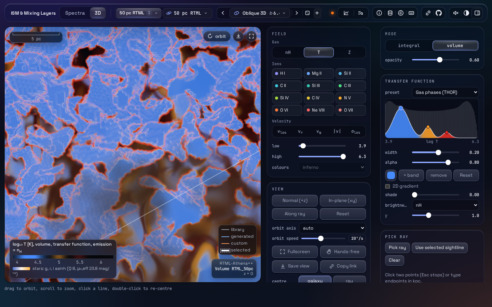
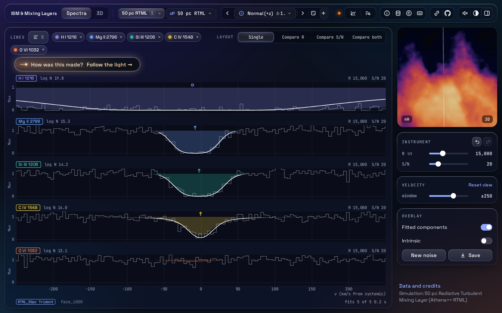
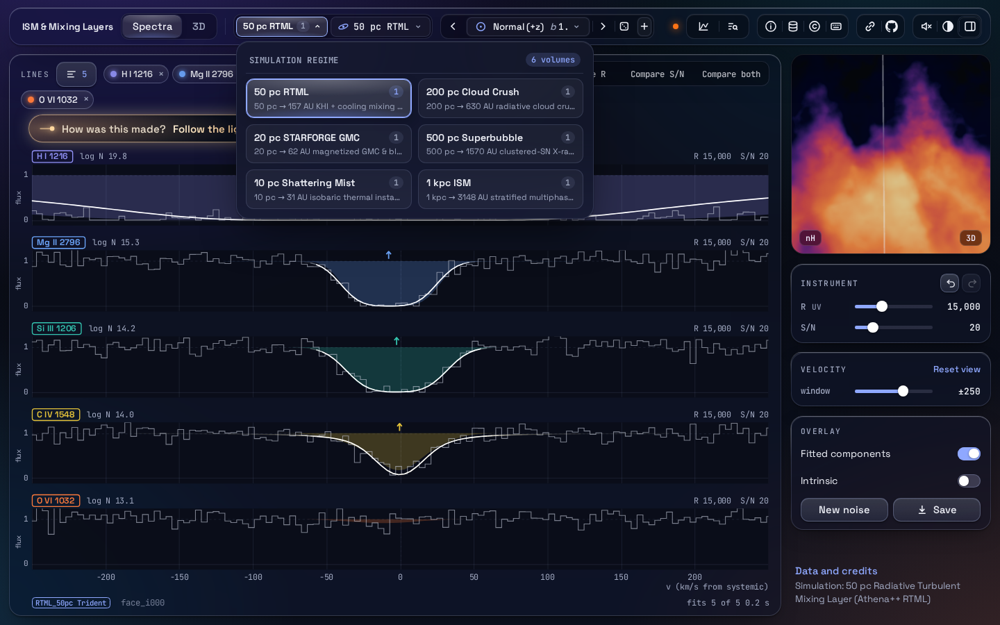
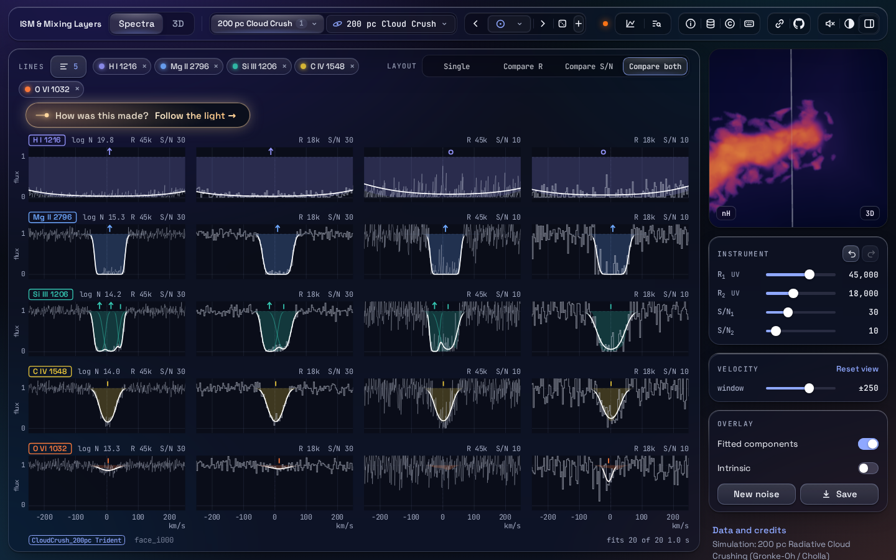
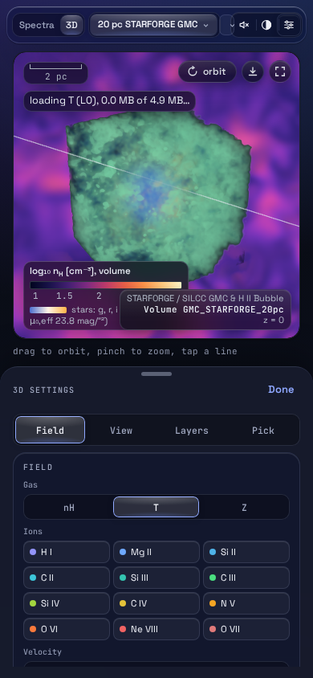

# Seeing the Interstellar Medium & Multiphase Mixing Layers — Interactive 3D & 12-Ion Absorption Atlas ($31\text{ AU} \rightarrow 1\text{ kpc}$)

[](https://ism.tanmaysingh.uk)
[](https://ism.tanmaysingh.uk/#tab=3d)
[](https://huggingface.co/datasets/tanmay-starslab/ism-atlas-3d)
[](BYO_SIMULATION.md)
[](LICENSE)

> **Live portal:** **[ism.tanmaysingh.uk](https://ism.tanmaysingh.uk)**
>
> Part of the **4-Scale Cosmic Gas Atlas**:
> - **[ISM & Mixing Layers](https://ism.tanmaysingh.uk)** ($31\text{ AU} \rightarrow 1\text{ kpc}$: radiative turbulent mixing layers, cloud crushing, STARFORGE GMCs, superbubbles, thermal instability mist & stratified ISM fountains)
> - **[CGM Galaxy Halo Atlas](https://galaxies.tanmaysingh.uk)** ($1\text{ kpc} \rightarrow 400\text{ kpc}$: TNG50-1 & FIRE-2 circumgalactic halos)
> - **[ICM Galaxy Cluster Atlas](https://icm.tanmaysingh.uk)** ($1\text{ Mpc} \rightarrow 4\text{ Mpc}$: TNG-Cluster intracluster medium)
> - **[IGM & Cosmic Web Atlas](https://igm.tanmaysingh.uk)** ($35\text{ Mpc} \rightarrow 303\text{ Mpc}$: intergalactic filaments & Ly$\alpha$ forest)



**Seeing the Interstellar Medium & Multiphase Mixing Layers** is a client-side WebGL2 3D volume + 12-ion Voigt absorption spectrum laboratory spanning **6 flagship modern ISM & sub-ISM simulation regimes ($31\text{ AU} \rightarrow 1\text{ kpc}$, 720 sightlines)** — plus a universal **Bring-Your-Own-Simulation (`tngsight.ingest`) CLI** that converts any 3D hydrodynamic or MHD simulation (`Athena++`, `Cholla`, `STARFORGE`, `FLASH`, `Pluto`, `ENZO`, `RAMSES`, `AREPO`, `GIZMO`, or `yt`-compatible HDF5/NumPy cutout) into a 5-level $256^3$ octree (`L0..L4` gas/ions/velocities + `S0..S4` starlight/dust) and 12-ion synthetic absorption atlas.

---

## Visual Tour

````carousel

<!-- slide -->

<!-- slide -->

<!-- slide -->

<!-- slide -->

````

---

## Six Flagship Modern ISM & Sub-ISM Regimes ($31\text{ AU} \rightarrow 1\text{ kpc}$, 720 Sightlines)

Switch seamlessly in the top bar between **6 landmark 3D multiphase ISM and sub-ISM regimes** hosted on Hugging Face **[`tanmay-starslab/ism-atlas-3d`](https://huggingface.co/datasets/tanmay-starslab/ism-atlas-3d)**, each built with **5 nested $256^3$ gas/ion/velocity levels (`L0..L4`, 18 fields per level)**, **5 nested $256^3$ RGBA starlight & dust extinction levels (`S0..S4`)**, and **120 synthetic 12-ion FP64 Voigt sightlines**:

| Volume ID | Label (`simKey`) | Simulation / Physical Regime | Box ($2H_0$) | `L0` Voxel | `L1` Voxel | `L2` Voxel | `L3` Voxel | `L4` Finest Voxel | Sightlines | Deep Links |
| :--- | :--- | :--- | :---: | :---: | :---: | :---: | :---: | :---: | :---: | :---: |
| **`RTML_50pc`** | `50 pc RTML` (`rtml`) | **RTML-Athena++** Radiative Turbulent Mixing Layer (Fielding+2020; Tan+2021; Ji+2019) | $50\text{ pc}$ | $0.195\text{ pc}$ | $0.0488\text{ pc}$ | $0.0122\text{ pc}$ | $0.00305\text{ pc}$ ($630\text{ AU}$) | **$0.00076\text{ pc}$ ($157\text{ AU}$)** | 120 | [Spectra](https://ism.tanmaysingh.uk/) · [3D](https://ism.tanmaysingh.uk/#tab=3d) |
| **`CloudCrush_200pc`** | `200 pc Cloud Crush` (`cloudcrush`) | **Gronke-Oh / Cholla** Radiative Cloud Crushing & Cometary Tail (Gronke & Oh 2018, 2020; Schneider+2020; Abruzzo+2022) | $200\text{ pc}$ | $0.781\text{ pc}$ | $0.195\text{ pc}$ | $0.0488\text{ pc}$ | $0.0122\text{ pc}$ ($2517\text{ AU}$) | **$0.00305\text{ pc}$ ($630\text{ AU}$)** | 120 | [Spectra](https://ism.tanmaysingh.uk/#sim=cloudcrush&g=CloudCrush_200pc) · [3D](https://ism.tanmaysingh.uk/#sim=cloudcrush&g=CloudCrush_200pc&tab=3d) |
| **`GMC_STARFORGE_20pc`** | `20 pc STARFORGE GMC` (`starforge`) | **STARFORGE / SILCC** Magnetized GMC Filament Network & Blister $\text{H II}$ Bubble (Grudić+2021, 2022; Walch+2015) | $20\text{ pc}$ | $0.0781\text{ pc}$ | $0.0195\text{ pc}$ | $0.00488\text{ pc}$ | $0.00122\text{ pc}$ ($252\text{ AU}$) | **$0.000305\text{ pc}$ ($62\text{ AU}$)** | 120 | [Spectra](https://ism.tanmaysingh.uk/#sim=starforge&g=GMC_STARFORGE_20pc) · [3D](https://ism.tanmaysingh.uk/#sim=starforge&g=GMC_STARFORGE_20pc&tab=3d) |
| **`Superbubble_500pc`** | `500 pc Superbubble` (`superbubble`) | **TIGRESS / PRFM** Clustered-SN X-ray Superbubble Chimney Breakout (Kim+2017; Fielding+2018; Orr+2022) | $500\text{ pc}$ | $1.953\text{ pc}$ | $0.488\text{ pc}$ | $0.122\text{ pc}$ | $0.0305\text{ pc}$ ($6295\text{ AU}$) | **$0.00763\text{ pc}$ ($1570\text{ AU}$)** | 120 | [Spectra](https://ism.tanmaysingh.uk/#sim=superbubble&g=Superbubble_500pc) · [3D](https://ism.tanmaysingh.uk/#sim=superbubble&g=Superbubble_500pc&tab=3d) |
| **`ShatteringMist_10pc`** | `10 pc Shattering Mist` (`shattering`) | **McCourt-Gronke** Isobaric Thermal Instability Shattering Mist (McCourt+2018; Gronke & Oh 2020b; Waters & Proga 2019) | $10\text{ pc}$ | $0.0391\text{ pc}$ | $0.00977\text{ pc}$ | $0.00244\text{ pc}$ | $0.00061\text{ pc}$ ($126\text{ AU}$) | **$0.000153\text{ pc}$ ($31\text{ AU}$)** | 120 | [Spectra](https://ism.tanmaysingh.uk/#sim=shattering&g=ShatteringMist_10pc) · [3D](https://ism.tanmaysingh.uk/#sim=shattering&g=ShatteringMist_10pc&tab=3d) |
| **`ISM_1kpc`** | `1 kpc ISM` (`ism`) | **TIGRESS-ISM** Stratified Multiphase ISM & Superbubble Fountain Patch (Kim & Ostriker 2017; Kim+2020) | $1\text{ kpc}$ | $3.906\text{ pc}$ | $0.977\text{ pc}$ | $0.244\text{ pc}$ | $0.0610\text{ pc}$ ($12,590\text{ AU}$) | **$0.01526\text{ pc}$ ($3148\text{ AU}$)** | 120 | [Spectra](https://ism.tanmaysingh.uk/#sim=ism&g=ISM_1kpc) · [3D](https://ism.tanmaysingh.uk/#sim=ism&g=ISM_1kpc&tab=3d) |

### Astrophysical Highlights of the 6 Volumes

1. **`RTML_50pc` (`50 pc RTML` — Radiative Turbulent Mixing Layer, $50\text{ pc} \rightarrow 157\text{ AU}$)**:
   - Models the shear-driven Kelvin–Helmholtz + radiative cooling interface between cold dense gas ($T \sim 10^4\text{ K}, n_{\text{H}} \sim 1\text{ cm}^{-3}$) and hot coronal wind ($T \sim 10^6\text{ K}, n_{\text{H}} \sim 10^{-2}\text{ cm}^{-3}, \Delta v = 160\text{ km/s}$), where turbulent mixing time $t_{\text{mix}}$ competes with radiative cooling time $t_{\text{cool}}$ ($\xi = t_{\text{mix}}/t_{\text{cool}} \sim 1$, Fielding et al. 2020; Tan, Oh & Gronke 2021).
   - Multi-scale fractal KHI rollers and entrained cold droplets down to $157\text{ AU}$ (`L4`), producing corrugated $T \sim 10^{4.8}\text{--}10^{5.5}\text{ K}$ skins rich in $\text{Si IV}, \text{C IV}, \text{N V}, \text{O VI}$.

2. **`CloudCrush_200pc` (`200 pc Cloud Crush` — Radiative Cloud Crushing & Cometary Tail, $200\text{ pc} \rightarrow 630\text{ AU}$)**:
   - Models a radiative cold cloud ($R_{\text{cl}} = 10\text{ pc}, T = 10^4\text{ K}, n_{\text{H}} = 1.5\text{ cm}^{-3}$) entrained and shattering in a supersonic hot galactic wind ($T = 3 \times 10^6\text{ K}, n_{\text{H}} = 10^{-3}\text{ cm}^{-3}, v_{\text{wind}} = 350\text{ km/s}$, Gronke & Oh 2018, 2020; Schneider et al. 2020 *Cholla*; Abruzzo et al. 2022).
   - 120 sightlines probe shattered cold core droplets ($\text{H I}, \text{Mg II}, \text{C II}, \text{Si II}$), cometary wake intermediate ions ($\text{Si III}, \text{C III}, \text{Si IV}, \text{C IV}$), and turbulent shear-layer hot ions ($\text{N V}, \text{O VI}, \text{Ne VIII}$).

3. **`GMC_STARFORGE_20pc` (`20 pc STARFORGE GMC` — Magnetized GMC & Blister $\text{H II}$ Bubble, $20\text{ pc} \rightarrow 62\text{ AU}$)**:
   - Models a magnetized supersonic turbulent Giant Molecular Cloud filament network ($n_{\text{H}} \sim 10^2\text{--}10^4\text{ cm}^{-3}$) sculpted by an expanding blister $\text{H II}$ photoionization front and OB stellar-wind feedback cavity (Grudić et al. 2021, 2022 *STARFORGE*; Walch et al. 2015 *SILCC*), with OB cluster starlight and dense filament dust lanes ($\tau_V$) in `S0..S4`.
   - 120 sightlines probe damped cold filaments ($\log N_{\text{HI}} \sim 20\text{--}22, \text{Mg II}, \text{Si II}, \text{C II}$), photoionized $\text{H II}$ blister walls ($\text{Si III}, \text{C III}, \text{Si IV}, \text{C IV}$), and wind-blown shock interfaces ($\text{N V}, \text{O VI}$).

4. **`Superbubble_500pc` (`500 pc Superbubble` — Clustered-SN X-ray Superbubble Breakout, $500\text{ pc} \rightarrow 1570\text{ AU}$)**:
   - Models a clustered-supernova superbubble carving a hot X-ray ($T \sim 3 \times 10^6\text{--}10^7\text{ K}$) chimney breakout through a stratified cold/warm $\text{H I}$ disk with swept-up radiative shells and fragmented wall pillars (Kim, Ostriker & Raileanu 2017; Fielding, Quataert & Martizzi 2018; Orr et al. 2022).
   - 120 sightlines probe the hot X-ray superbubble interior ($\text{O VII}\ 21.6\ \text{\AA}, \text{Ne VIII}\ 770\ \text{\AA}$), conductive/turbulent shell walls ($\text{O VI}, \text{N V}, \text{C IV}$), and swept-up cold shell fragments ($\text{H I}, \text{Mg II}, \text{C II}, \text{Si III}$).

5. **`ShatteringMist_10pc` (`10 pc Shattering Mist` — Isobaric Thermal Instability Mist, $10\text{ pc} \rightarrow 31\text{ AU}$)**:
   - Models an isobaric thermally unstable cooling mist of thousands of coagulating $r \sim c_s t_{\text{cool}} \sim 100\text{--}500\text{ AU}$ cold cloudlets ($T = 10^4\text{ K}, n_{\text{H}} = 3\text{ cm}^{-3}$) suspended in a transonic warm-hot $4 \times 10^5\text{ K}$ medium (McCourt et al. 2018; Gronke & Oh 2020b; Waters & Proga 2019), zooming down to **$31\text{ AU}$ voxels (`L4`)** that directly resolve the fundamental cooling length $c_s t_{\text{cool}}$.
   - 120 sightlines probe multi-component "mist" absorption honeycombs where a single sightline intersects 5–15 distinct $c_s t_{\text{cool}}$ cloudlets and their $\text{O VI}/\text{C IV}/\text{Si III}/\text{Mg II}$ conductive/turbulent skins.

6. **`ISM_1kpc` (`1 kpc ISM` — Stratified Multiphase ISM & Superbubble Fountain, $1\text{ kpc} \rightarrow 3148\text{ AU}$)**:
   - Models a $1\text{ kpc}$ stratified galactic disk patch with CNM/molecular midplane filaments, WNM/WIM layers, biconical SN superbubble chimneys, and entrained fountain clouds (Kim & Ostriker 2017 *TIGRESS*; Kim et al. 2020).

---

## 18-Field 3D Volume Rendering & 12-Ion Spectroscopic Ladder

Every nested level (`L0..L4`) stores 18 physical 3D fields (plus 4-channel RGBA starlight + dust `S0..S4`), and every sightline synthesizes exact FP64 Voigt profiles across the 12-ion multiphase temperature ladder:

| Field / Ion | Transition $\lambda_0$ | Band | Characteristic Phase / Temperature | Physical Role in ISM & Mixing Layers |
| :--- | :---: | :---: | :---: | :--- |
| **`nH`, `T`, `Z`** | — | 3D Base | $10^2\text{--}10^7\text{ K}$ | Hydrogen density, gas temperature, metallicity |
| **`vx`, `vy`, `vz`** | — | 3D Velocity | $\pm 400\text{ km/s}$ | 3D shear, turbulent eddy, shock & outflow kinematics |
| **`stars` (`S0..S4`)** | $i, r, g + \kappa_V$ | 3D RGBA | OB clusters + dust | 3D stellar emission & cold-filament dust extinction lanes |
| **`HI`** | $1215.67\ \text{\AA}$ | FUV | $10^2\text{--}2\times 10^4\text{ K}$ | Self-shielded cold neutral cores, GMC filaments & mist droplets |
| **`MgII`** | $2796.35\ \text{\AA}$ | NUV | $10^{3.8}\text{--}10^{4.2}\text{ K}$ | Cold dense clumps & swept-up shell fragments |
| **`SiII`** | $1260.42\ \text{\AA}$ | FUV | $10^{3.8}\text{--}10^{4.3}\text{ K}$ | Low-ionization cold cloudlet cores & blister rims |
| **`CII`** | $1334.53\ \text{\AA}$ | FUV | $10^{3.8}\text{--}10^{4.5}\text{ K}$ | Cold/warm neutral-to-ionized transition boundary |
| **`SiIII`** | $1206.50\ \text{\AA}$ | FUV | $10^{4.3}\text{--}10^{4.8}\text{ K}$ | Photoionized $\text{H II}$ blister walls & outer cooling skins |
| **`CIII`** | $977.02\ \text{\AA}$ | FUV | $10^{4.5}\text{--}10^{5.0}\text{ K}$ | Warm-hot KHI roller boundaries & cometary wakes |
| **`SiIV`** | $1393.76\ \text{\AA}$ | FUV | $10^{4.7}\text{--}10^{5.1}\text{ K}$ | Intermediate-temperature turbulent mixing interfaces |
| **`CIV`** | $1548.19\ \text{\AA}$ | FUV | $10^{4.9}\text{--}10^{5.3}\text{ K}$ | Peak radiative cooling-layer diagnostic ($\xi \sim 1$) |
| **`NV`** | $1238.82\ \text{\AA}$ | FUV | $10^{5.1}\text{--}10^{5.5}\text{ K}$ | Conductive & turbulent shear boundary layers |
| **`OVI`** | $1031.91\ \text{\AA}$ | FUV | $10^{5.3}\text{--}10^{5.7}\text{ K}$ | Coronal mixing interface & superbubble shell walls |
| **`NeVIII`** | $770.41\ \text{\AA}$ | EUV | $10^{5.7}\text{--}10^{6.1}\text{ K}$ | Hot wind-shock boundary & superbubble transition |
| **`OVII`** | $21.60\ \text{\AA}$ | X-ray | $10^{6.0}\text{--}10^{6.8}\text{ K}$ | Hot ambient wind & clustered-SN X-ray superbubble interior |

---

## Bring Your Own Simulation (`python -m tngsight.ingest`)

Ingest any 3D simulation snapshot (`Athena++`, `Cholla`, `STARFORGE`, `FLASH`, `Pluto`, `ENZO`, `RAMSES`, `AREPO`, `GIZMO`, or any `yt` / HDF5 / `.npz` grid) or rebuild all 6 flagship 5-level volumes from the command line:

```bash
# Build all 6 flagship 5-level (L0..L4 + S0..S4) ISM & sub-ISM volumes (720 sightlines)
python scripts/build_ism_showcase.py --levels L0,L1,L2,L3,L4 --n 256 --nrays 120 --workers 16

# Or synthesize any single built-in 5-level regime preset:
python -m tngsight.ingest --preset cloud_crush     --out docs/ism/data/gal/CloudCrush_200pc    --half-pc 100 --levels L0,L1,L2,L3,L4 --nrays 120
python -m tngsight.ingest --preset starforge_gmc   --out docs/ism/data/gal/GMC_STARFORGE_20pc  --half-pc 10  --levels L0,L1,L2,L3,L4 --nrays 120
python -m tngsight.ingest --preset superbubble     --out docs/ism/data/gal/Superbubble_500pc   --half-pc 250 --levels L0,L1,L2,L3,L4 --nrays 120
python -m tngsight.ingest --preset shattering_mist --out docs/ism/data/gal/ShatteringMist_10pc --half-pc 5   --levels L0,L1,L2,L3,L4 --nrays 120

# Or ingest your own 3D simulation snapshot (.hdf5, .athdf, .npz, or yt dataset):
python -m tngsight.ingest --input /path/to/my_sim.hdf5 --out docs/ism/data --half-pc 25 --levels L0,L1,L2,L3,L4 --nrays 120
```

See **[BYO_SIMULATION.md](BYO_SIMULATION.md)** for full details on supported HDF5/NumPy/yt schemas and custom scale boxes.

---

## Running Locally & Testing

```bash
# Serve the static explorer locally
python3 -m http.server 8080 --directory docs
# Open http://localhost:8080/ism/

# Run Python unit tests
pytest tests/test_ism_ingest.py -v

# Run JS static & unit contract tests
node tests/js/ui_static.mjs docs/ism
node tests/js/galaxies_unit.mjs
```

---

## Credits & References

- **Radiative Turbulent Mixing Layers (`RTML_50pc`)**: Fielding et al. (2020, *ApJL* 894, L24); Tan, Oh & Gronke (2021, *MNRAS* 502, 3179); Ji, Oh & Masterson (2019, *MNRAS* 487, 737).
- **Radiative Cloud Crushing (`CloudCrush_200pc`)**: Gronke & Oh (2018, *MNRAS* 480, L111; 2020, *MNRAS* 492, 1970); Schneider et al. (2020, *ApJ* 895, 43, *Cholla*); Abruzzo et al. (2022, *ApJ* 925, 199).
- **Magnetized GMC & Blister $\text{H II}$ Bubble (`GMC_STARFORGE_20pc`)**: Grudić et al. (2021, *MNRAS* 506, 2199; 2022, *MNRAS* 512, 216, *STARFORGE*); Walch et al. (2015, *MNRAS* 454, 238, *SILCC*).
- **Clustered-SN Superbubble Breakout (`Superbubble_500pc`)**: Kim, Ostriker & Raileanu (2017, *ApJ* 834, 25); Fielding, Quataert & Martizzi (2018, *MNRAS* 481, 3325); Orr et al. (2022, *MNRAS* 511, 6160).
- **Isobaric Thermal Instability Shattering Mist (`ShatteringMist_10pc`)**: McCourt et al. (2018, *MNRAS* 473, 5407); Gronke & Oh (2020b, *MNRAS* 494, L27); Waters & Proga (2019, *ApJ* 875, 158).
- **Stratified Multiphase ISM (`ISM_1kpc`)**: Kim & Ostriker (2017, *ApJ* 846, 133, *TIGRESS*); Kim et al. (2020, *ApJ* 900, 61).
- **Spectroscopy & Atomic Data**: Trident (Hummels, Smith & Silvia 2017), CLOUDY (Ferland et al. 2017), Morton (2003), Verner et al. (1996).
